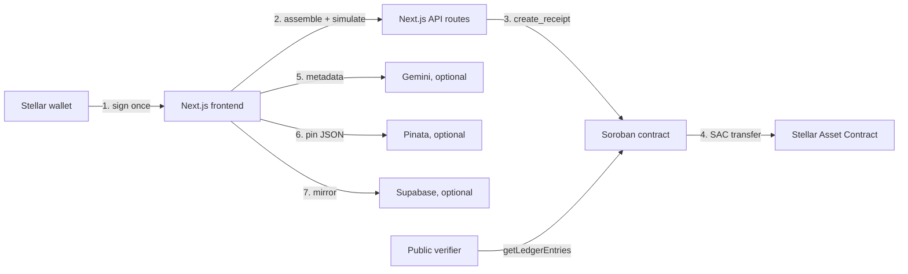

<p align="center">
  <strong>StellarProof</strong><br />
  Every Stellar payment deserves a receipt.
</p>

<p align="center">
  <a href="https://github.com/techAlhaji/stellar-proof/actions/workflows/ci.yml"></a>
  <a href="https://github.com/techAlhaji/stellar-proof/blob/main/LICENSE"></a>
  
  
  
</p>

> **Status:** Testnet only. Not audited. Demo Mode is available and off by default; live mode fails closed if IPFS is not configured. The contract has no admin key, no upgrade path and no custody.

StellarProof turns a Stellar payment into a verifiable business record. A payer sends XLM or any Stellar asset, and the same Soroban invocation moves the funds through the asset's Stellar Asset Contract and writes a receipt with the parties, amount, purpose and an IPFS metadata pointer. The payer can export a PDF; anyone can verify the record by reading Soroban storage directly, without an account, an indexer or trust in this app.

Nothing in the payment, receipt or verification path touches an EVM chain. The product is built on Stellar and Soroban.

## Contents

- [How it works](#how-it-works)
- [Architecture](#architecture)
- [Multi-asset payments](#multi-asset-payments)
- [Verification and its limits](#verification-and-its-limits)
- [Repository layout](#repository-layout)
- [Quick start](#quick-start)
- [Environment](#environment)
- [Contract API](#contract-api)
- [HTTP API](#http-api)
- [Testing and CI](#testing-and-ci)
- [Deployment](#deployment)
- [Known limitations](#known-limitations)
- [Documentation](#documentation)
- [Contributing](#contributing)
- [Security](#security)
- [Maintainers](#maintainers)
- [Contributors](#contributors)
- [License](#license)

## How it works

A payment and its receipt are one Soroban invocation:

1. `POST /api/stellar/prepare-payment` loads the payer account, builds `create_receipt(sender, receipt_id, receiver, token, amount, symbol, cid, purpose)` and simulates it with `server.prepareTransaction()`. Simulation attaches the storage footprint, auth requirements and resource fee.
2. The wallet signs the envelope once through Stellar Wallets Kit (`signTransaction`).
3. `POST /api/stellar/submit-payment` submits it over Soroban RPC and polls until `SUCCESS`.

Inside the contract, `token::Client::transfer()` moves the asset from the payer to the recipient through its Stellar Asset Contract. The receipt is then written to persistent storage. Either both happen or the transaction reverts.

## Architecture



| Layer | Technology |
| --- | --- |
| Frontend | Next.js 14 App Router, React 18, TypeScript, Tailwind CSS |
| Wallet | Stellar Wallets Kit (Freighter, xBull, Albedo, Lobstr, Hana, Rabet, hardware wallets) |
| Network | Stellar Testnet: XLM and issued assets through Stellar Asset Contracts |
| SDK | `@stellar/stellar-sdk` 17.x (Horizon + Soroban RPC) |
| Contract | Rust, `soroban-sdk` 29.0.1, `wasm32v1-none` |
| Metadata | Pinata IPFS (optional) |
| Database | Supabase (optional), local-first fallback |
| AI | Google Gemini 1.5 Flash (optional) |

## Multi-asset payments

`create_receipt` takes `token: Address`, so any Stellar Asset Contract works:

- **XLM** — the native asset contract, resolved from the network passphrase.
- **USDC** — `USDC:<issuer>`, Circle's Testnet issuer by default. The payer needs a trustline and balance; both are checked before signing.
- **Any other asset** — pass its SAC address as `assetSac` to `/api/stellar/prepare-payment`. The asset's Stellar Asset Contract must be deployed first (`stellar contract asset deploy --asset CODE:ISSUER`), otherwise the API returns a clear error.

## Verification and its limits

`/verify/[id]` derives the Soroban storage key for `DataKey::Receipt(receipt_id)` and reads it with `getLedgerEntries`. No account, wallet or simulation is required to prove a record exists.

What that proves:

- A transaction wrote a receipt with this id.
- The recorded sender, receiver, amount, symbol, purpose and CID are the values in contract storage.
- The record has not been changed since the write.

What it does **not** prove:

- That the recipient agreed to the purpose or delivered anything. Only the payer signs.
- That the asset is the one named by `token_symbol`. v0.1 stores the symbol the payer supplied, not the token address.
- That the IPFS payload matches the payment. The CID is a pointer, not a hash checked onchain.
- That the record will exist forever. Persistent entries are extended to about 90 days; v0.1 has no renewal function.

Read [SECURITY.md](SECURITY.md) before making stronger claims.

## Repository layout

```
stellar-proof/
├── app/                         # Next.js App Router
│   ├── api/ai/                  # AI metadata
│   ├── api/ai-search/           # natural-language receipt search
│   ├── api/ipfs/                # Pinata pinning
│   ├── api/stellar/             # prepare, submit, account, receipt reads
│   ├── docs/                    # in-app documentation page
│   └── verify/[id]/             # public verification page
├── components/                  # dashboard, payment, receipt, wallet UI
├── contracts/stellarproof/
│   ├── src/lib.rs               # one contract, one responsibility
│   └── src/test.rs
├── docs/
│   └── demo_script.md
├── lib/
│   ├── stellar.ts               # client-safe config, assets, stroop math
│   ├── stellar-server.ts        # server-only SDK boundary
│   ├── db.ts                    # local-first receipt cache
│   └── supabase.ts
├── scripts/
│   ├── deploy.ts                # wasm install + contract creation
│   └── create-issues.sh         # planned issue batch
├── tests/                       # node:test suites
├── .github/workflows/ci.yml
├── Cargo.toml                   # workspace + release profile
└── package.json
```

## Quick start

### Prerequisites

- Node.js 20+
- pnpm 12.3.4 (CI and local)
- Rust stable with the `wasm32v1-none` target
- Stellar CLI 28.1.0

### 1. Install

```bash
pnpm install --frozen-lockfile
```

The install allow-list for packages that run build scripts lives in `pnpm-workspace.yaml`. Without it, pnpm 12 fails with `ERR_PNPM_IGNORED_BUILDS`.

### 2. Configure

```bash
cp .env.example .env
```

The v0.1 contract is already deployed on Testnet. For live writes, set the deployed ID:

```dotenv
NEXT_PUBLIC_STELLARPROOF_CONTRACT_ID=CAXXWDCD6DTCLOCNILPUF625MFTOFK7RKZDCYRT74GBLVD63LF42AFWQ
```

Use a funded Testnet wallet and configure `PINATA_JWT` for receipt metadata pinning. Without a contract ID the app runs in local-only mode; without a Pinata key, live IPFS pinning fails with a clear 503. Demo Mode does not call Pinata.

### 3. Build and deploy a new contract version (optional)

To redeploy after changing the contract, create and fund a Testnet deployer, then build and deploy:

```bash
stellar keys generate stellarproof-deployer --network testnet
stellar keys fund stellarproof-deployer --network testnet

rustup target add wasm32v1-none
pnpm contract:build

STELLAR_DEPLOYER_SECRET=$(stellar keys secret stellarproof-deployer) pnpm deploy:testnet
```

The script prints a new contract ID. Put it in `.env` as `NEXT_PUBLIC_STELLARPROOF_CONTRACT_ID` and restart the app. There is no `initialize` call. Never use a mainnet secret for this Testnet deployment.

### 4. Run

```bash
pnpm dev
```

Open [http://localhost:3000](http://localhost:3000), connect a funded Testnet wallet, and send a payment.

### 5. Test

```bash
pnpm typecheck
pnpm lint
pnpm test
pnpm build

pnpm contract:test
```

## Environment

| Variable | Scope | Required | Purpose |
| --- | --- | --- | --- |
| `NEXT_PUBLIC_STELLARPROOF_CONTRACT_ID` | client + server, build-time | Live mode | Deployed contract id (`C...`) |
| `STELLAR_DEPLOYER_SECRET` | local/CI only | Deploy only | Secret key (`S...`) of a funded Testnet deployer |
| `NEXT_PUBLIC_STELLAR_RPC_URL` | client + server, build-time | No | Soroban RPC; defaults to Testnet |
| `NEXT_PUBLIC_STELLAR_HORIZON_URL` | client + server, build-time | No | Horizon; defaults to Testnet |
| `NEXT_PUBLIC_USDC_ISSUER` | client + server, build-time | No | USDC issuer; defaults to Circle Testnet |
| `STELLAR_RPC_URL` | deploy script | No | Override for the deploy RPC |
| `STELLAR_NETWORK_PASSPHRASE` | deploy script | No | Override for the network passphrase |
| `STELLARPROOF_WASM_PATH` | deploy script | No | Override for the wasm path |
| `GEMINI_API_KEY` | server only | No | AI metadata and search |
| `PINATA_JWT` | server only | Live IPFS | Pin receipt JSON |
| `NEXT_PUBLIC_SUPABASE_URL` | client + server | No | Receipt mirror |
| `NEXT_PUBLIC_SUPABASE_ANON_KEY` | client | No | Receipt mirror; requires RLS |

The deployed v0.1 Testnet contract ID is `CAXXWDCD6DTCLOCNILPUF625MFTOFK7RKZDCYRT74GBLVD63LF42AFWQ`; [view it on Stellar Expert](https://stellar.expert/explorer/testnet/contract/CAXXWDCD6DTCLOCNILPUF625MFTOFK7RKZDCYRT74GBLVD63LF42AFWQ).

`NEXT_PUBLIC_*` values are inlined at build time. Changing one requires a new deployment.

## Contract API

`contracts/stellarproof/src/lib.rs` (v0.1, deployed as a single contract):

```rust
create_receipt(env, sender, receipt_id, receiver, token: Address, amount: i128,
               token_symbol, ipfs_hash, purpose) -> Result<Receipt, Error>
get_receipt(env, receipt_id) -> Result<Receipt, Error>
verify_receipt(env, receipt_id) -> Option<Receipt>
get_receipts_by_user(env, user) -> Vec<String>
```

- `create_receipt` transfers `amount` of `token` from `sender` to `receiver`, then stores the receipt. Funds move only if the receipt is written.
- `sender.require_auth()` guarantees only the payer can spend their funds and write the receipt. The recipient does not sign.
- Receipts live in persistent storage (`DataKey::Receipt(id)`) with a 90-day TTL bump, indexed per user in `DataKey::UserReceipts(address)`.
- Every registration emits a `ReceiptAnchored` event with the receipt id, parties, amount, token symbol and IPFS CID for indexers.
- The key layout is deterministic (`["Receipt", id]`), so any client can read a receipt with `getLedgerEntries`.
- Errors: `EmptyReceiptId` (1), `EmptyIpfsHash` (2), `InvalidAmount` (3), `ReceiptAlreadyExists` (4), `ReceiptNotFound` (5).

The v0.2 plan adds the token address, permissionless TTL renewal and paged history. It is not deployed yet.

## HTTP API

| Route | Method | Input | Success |
| --- | --- | --- | --- |
| `/api/stellar/prepare-payment` | POST | `sender, receiver, amount, receiptId, ipfsHash, purpose, assetCode?, assetSac?, tokenSymbol?` | `{ success, xdr, networkPassphrase, amountStroops }` |
| `/api/stellar/submit-payment` | POST | `{ signedXdr }` | `{ success, txHash }` |
| `/api/stellar/receipt` | GET | `?id=` | `{ success, receipt }` |
| `/api/stellar/account` | GET | `?address=` | `{ success, account }` |
| `/api/ipfs` | POST | `{ receiptId, metadata }` | `{ success, ipfsHash, gatewayUrl }` |
| `/api/ai` | POST | payment fields | `{ success, aiTitle, aiSummary, aiExplanation, aiTags, category }` |
| `/api/ai-search` | POST | `{ query, receipts }` | `{ success, matchingIds }` |

Errors are `{ error: string }`. Stellar routes are `force-dynamic` with `fetchCache = "force-no-store"`.

## Testing and CI

- `pnpm test` runs 20 tests across helpers, API route validation and no-contract behavior using Node's test runner through `tsx`.
- `pnpm contract:test` runs the Rust unit tests.
- CI has two jobs: `app` (install, typecheck, lint, test, build) and `contract` (format, clippy, test, wasm build with Stellar CLI 28.1.0). The contract job uses `stellar contract build` so Soroban SDK build metadata is set correctly. Both are required on `main` once branch protection is enabled.

See [CONTRIBUTING.md](CONTRIBUTING.md) for the local commands and review rules.

## Deployment

The reference deployment is Vercel for the Next.js app and Stellar Testnet for the contract. Setup and environment details are in the [documentation](/docs#local-setup).

Live app: [https://proofpal-ai.vercel.app](https://proofpal-ai.vercel.app).

Soroban v0.1 contract deployed on Stellar Testnet: [`CAXXWDCD6DTCLOCNILPUF625MFTOFK7RKZDCYRT74GBLVD63LF42AFWQ`](https://stellar.expert/explorer/testnet/contract/CAXXWDCD6DTCLOCNILPUF625MFTOFK7RKZDCYRT74GBLVD63LF42AFWQ). Set `NEXT_PUBLIC_STELLARPROOF_CONTRACT_ID` to this ID when configuring a live app deployment. This is Testnet-only and unaudited.

## Known limitations

These are known and stated, not hidden:

- **The receipt is payer-attested.** The recipient does not sign.
- **v0.1 does not store the token address.** `token_symbol` is caller-supplied.
- **Receipts expire after about 90 days.** There is no renewal function in v0.1.
- **History is per browser.** The dashboard reads `localStorage`; `get_receipts_by_user` is unused.
- **The PDF is not a tax document.** It has no tax fields, currency conversion or accounting integration.
- **No audit.** The contract and app are unaudited.
- **Testnet only.** Do not custody real funds.

## Documentation

- [StellarProof docs](/docs) — overview, payment flow, verification, contract and API reference, local setup.

## Contributing

Read [CONTRIBUTING.md](CONTRIBUTING.md). The short version:

1. Pick an issue with a clear acceptance test.
2. Branch from `main`.
3. Commit with Conventional Commits. Stage specific files, never `git add .`.
4. Run `pnpm typecheck && pnpm lint && pnpm test && pnpm build`.
5. Open a pull request. The `app` and `contract` checks must pass.

Good first issues are labelled `good first issue`. Contract changes are labelled `contract` and need a specification update.

## Security

Do not open a public issue for a vulnerability. Use [GitHub private vulnerability reporting](https://github.com/techAlhaji/stellar-proof/security/advisories/new). See [SECURITY.md](SECURITY.md) for scope, response targets and the audit disclaimer.

## Maintainers

| Maintainer | Role | Contact |
| --- | --- | --- |
| [techAlhaji](https://github.com/techAlhaji) | Maintainer | [GitHub Issues](https://github.com/techAlhaji/stellar-proof/issues) |

## Contributors

[](https://github.com/techAlhaji/stellar-proof/graphs/contributors)

## License

MIT. See [LICENSE](LICENSE).
