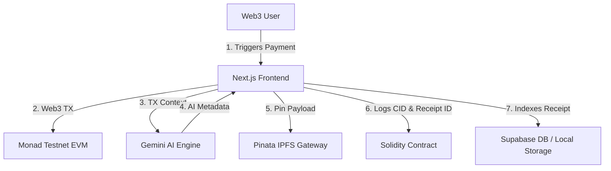

# 🚀 ProofPal AI — Onchain Crypto Receipts & Verification

> **Theme**: BuildAnything - Spark Hackathon MVP
> **Tagline**: *Every crypto payment deserves a receipt.*

ProofPal AI is a production-quality MVP designed to solve a major personal crypto problem: transaction history tracking. It automatically generates AI-powered, cryptographically verifiable, and IPFS-stored professional payment receipts for transactions on the Monad Testnet, allowing users to search their payments using natural language and export beautiful, tax-ready PDF invoices.

---

## 🛠️ Tech Stack & Architecture

* **Frontend**: Next.js 14 App Router, TypeScript, TailwindCSS v3, Framer Motion
* **Wallet**: Wagmi, RainbowKit, Viem
* **Smart Contract**: Solidity, Hardhat, Monad Testnet
* **Storage & Database**: Pinata IPFS Gateway, Supabase (with offline local failover)
* **AI Service**: Google Gemini (1.5 Flash Model)



---

## 📁 Project Folder Structure

```
proofpal-ai/
├── app/                  # Next.js App Router (Layout, Page, Global CSS)
│   ├── api/              # API Serverless Routes
│   │   ├── ai/           # Gemini AI Receipt Summary Generator
│   │   ├── ai-search/    # Gemini Natural Language Query Parser
│   │   └── ipfs/         # Pinata IPFS Pinning Gateway
│   ├── globals.css       # Custom design system (glassmorphic theme)
│   ├── layout.tsx        # HTML wrapper & Wallet provider
│   └── page.tsx          # Router page coordinator
├── components/           # UI Component blocks
│   ├── Landing.tsx       # Landing page (Hero, features, timelines)
│   ├── Sidebar.tsx       # Navigation drawer & wrong-network warnings
│   ├── Overview.tsx      # Metrics, Recharts volume area charts, category pie charts
│   ├── ReceiptsList.tsx  # Natural language search input, sorting filters, history card grids
│   ├── CreatePayment.tsx # Send MON form, signatures, AI / IPFS / contract writer
│   ├── ReceiptDetail.tsx # Stripe-like white receipt card, vector PDF exporter, verification QR
│   └── Settings.tsx      # Demo mode toggle, cache purging, RPC connection diagnostics
├── contracts/            # Smart contracts
│   └── ProofPalReceipts.sol # Solidity metadata registry
├── scripts/              # deployment automation scripts
│   └── deploy.ts         # Hardhat compiler/deployer script
├── lib/                  # Services and clients
│   ├── db.ts             # Offline-first local storage client & Supabase sync engine
│   └── supabase.ts       # Supabase client wrapper
├── docs/                 # Documentation deliverables
│   └── demo_script.md    # 3-minute video presentation talking points
├── hardhat.config.ts     # Solidity hardhat settings
├── tailwind.config.js    # Tailwind v3 configurations
└── package.json          # Node modules build file
```

---

## 🚀 Setup and Installation Guide

### Prerequisites
* **Node.js** version `18.x` or `20.x`
* **pnpm** (preferred) or **npm**

### 1. Clone & Install Dependencies
```bash
cd proofpal-ai
pnpm install
```

### 2. Configure Environment Variables
Copy the `.env.example` file to `.env.local` and input your keys:
```bash
cp .env.example .env.local
```
* `GEMINI_API_KEY`: Get a free key from [Google AI Studio](https://aistudio.google.com/).
* `PINATA_JWT`: Get an IPFS pinning JWT from [Pinata](https://pinata.cloud/).
* `NEXT_PUBLIC_SUPABASE_URL` / `NEXT_PUBLIC_SUPABASE_ANON_KEY`: Get from [Supabase](https://supabase.com/).
* `PRIVATE_KEY`: Your Monad Testnet deployer wallet private key (e.g. from MetaMask).

### 3. Run Locally
```bash
pnpm dev
```
Open [http://localhost:3000](http://localhost:3000) in your browser.

---

## 📜 Monad Testnet Smart Contract Setup

### Monad Testnet Config
* **Network Name**: Monad Testnet
* **RPC URL**: `https://testnet-rpc.monad.xyz`
* **Chain ID**: `10143`
* **Currency Symbol**: `MON`
* **Block Explorer**: `https://testnet.monadexplorer.com`

### Compile Solidity
```bash
pnpm compile
```

### Deploy to Monad Testnet
Make sure your `.env.local` contains a valid `PRIVATE_KEY` with testnet MON:
```bash
pnpm run deploy:monad
```

---

## 📦 Vercel Deployment Instructions

1. Install the Vercel CLI or import the project directly via Vercel Dashboard.
2. In Vercel Project Settings, add the environment variables defined in your `.env.local` file:
   * `GEMINI_API_KEY`
   * `PINATA_JWT`
   * `NEXT_PUBLIC_SUPABASE_URL`
   * `NEXT_PUBLIC_SUPABASE_ANON_KEY`
3. Set the build command to `npm run build` or `pnpm build`.
4. Deploy:
   ```bash
   vercel --prod
   ```

---

## 🏆 Hackathon Judging Checklist

Here is how ProofPal AI checks all boxes to maximize the **BuildAnything - Spark** scoring:

1. **Practical Usefulness**: Directly solves receipt management for accounting and tax purposes, which is a major point of friction for crypto users.
2. **Working Product**: Runs out of the box. Includes a **Demo Mode Toggle** in Settings allowing judges to test the entire signature, upload, AI metadata generation, and contract deployment flow instantly without requiring testnet gas or configuration.
3. **Great UX**: Clean dark-mode first design system, smooth Framer Motion tab transitions, and real-time step loaders.
4. **Clean Code**: High modularity (separated components, database helpers, clean hooks, and type interfaces).
5. **Real Solidity integration**: Hardhat setups deploy real contracts to Monad Testnet, saving hashes and metadata directly to onchain storage.
