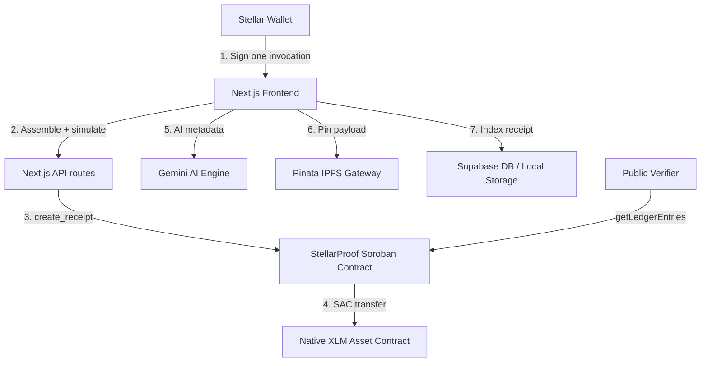

# 🚀 StellarProof — Onchain Stellar Receipts & Verification

> **Tagline**: *Every Stellar payment deserves a receipt.*

StellarProof turns Stellar payments into professional, cryptographically verifiable receipts. Send XLM from any Stellar wallet, and in the same atomic transaction StellarProof:

1. Anchors the receipt metadata (amount, parties, purpose, IPFS CID) in a **Rust Soroban smart contract** on Stellar.
2. Pins the full AI-generated invoice payload to **IPFS**.
3. Stores the receipt locally (and in Supabase when configured) for natural-language search and tax-ready PDF export.

Nothing in the payment, receipt or verification path touches an EVM chain — the entire product is built on Stellar and Soroban.

---

## 🏗️ Tech Stack & Architecture

* **Frontend**: Next.js 14 App Router, TypeScript, TailwindCSS v3, Framer Motion
* **Wallet**: [Stellar Wallets Kit](https://stellarwalletskit.dev) (Freighter, xBull, Albedo, Lobstr, Hana, Rabet, WalletConnect, hardware wallets)
* **Blockchain**: Stellar Testnet — native XLM payments + Soroban smart contracts
* **SDK**: `@stellar/stellar-sdk` (Horizon + Soroban RPC)
* **Smart Contract**: Rust + `soroban-sdk` 29
* **Storage & Database**: Pinata IPFS Gateway, Supabase (with offline local failover)
* **AI Service**: Google Gemini (1.5 Flash)



### How the one-signature flow works

A payment and its receipt are a **single Soroban invocation**:

1. `POST /api/stellar/prepare-payment` loads the sender account, builds `create_receipt(sender, receipt_id, receiver, token, amount, …)` and simulates it with `server.prepareTransaction()` so the storage footprint, auth requirements and resource fee are attached.
2. The wallet signs the envelope once through Stellar Wallets Kit (`signTransaction`).
3. `POST /api/stellar/submit-payment` submits it over Soroban RPC and polls until `SUCCESS`.

Inside the contract, `token::Client::transfer()` moves XLM from the sender to the recipient through the native Stellar Asset Contract, then the receipt metadata is written to persistent storage. Either both happen or the transaction reverts.

Verification is stateless: the public `/verify/[id]` page asks the server to derive the Soroban storage key for `DataKey::Receipt(receipt_id)` and read it with `getLedgerEntries`. No account, wallet or simulation is required to prove a receipt exists.

---

## 📁 Project Folder Structure

```
stellarproof/
├── app/                        # Next.js App Router
│   ├── api/                    # AI summary, AI search, IPFS pinning routes
│   ├── verify/[id]/            # Public Soroban-powered receipt verification
│   ├── layout.tsx
│   └── page.tsx
├── components/
│   ├── WalletProvider.tsx      # Stellar Wallets Kit context (connect/sign)
│   ├── ConnectWalletButton.tsx
│   ├── Landing.tsx
│   ├── Sidebar.tsx
│   ├── Overview.tsx
│   ├── ReceiptsList.tsx
│   ├── CreatePayment.tsx       # XLM payment + Soroban receipt anchoring
│   ├── ReceiptDetail.tsx       # Receipt paper, verification, PDF export
│   └── Settings.tsx
├── lib/
│   ├── stellar.ts              # Network config, Soroban reads, atomic payment
│   ├── db.ts                   # Local-first storage + Supabase sync
│   └── supabase.ts
├── contracts/stellarproof/     # Rust Soroban contract
│   ├── Cargo.toml
│   └── src/{lib.rs,test.rs}
├── scripts/deploy.ts           # Installs WASM + creates the contract
├── Cargo.toml                  # Cargo workspace + release profile
└── .env.example
```

---

## 🚀 Setup and Installation Guide

### Prerequisites

* Node.js `18.x` or `20.x`
* Rust with the `wasm32v1-none` target and [Stellar CLI](https://developers.stellar.org/docs/tools/developer-tools/cli/install-cli) v25.2+ (for building/deploying the contract)

### 1. Install dependencies

```bash
pnpm install
```

### 2. Configure environment variables

```bash
cp .env.example .env
```

| Variable | Purpose |
| --- | --- |
| `NEXT_PUBLIC_STELLARPROOF_CONTRACT_ID` | Deployed Soroban contract id (`C...`) |
| `STELLAR_DEPLOYER_SECRET` | Secret key (`S...`) of a funded Testnet deployer, used only by `scripts/deploy.ts` |
| `NEXT_PUBLIC_STELLAR_RPC_URL` | Soroban RPC endpoint (defaults to `https://soroban-testnet.stellar.org`) |
| `GEMINI_API_KEY` | AI summaries and natural-language search (optional) |
| `PINATA_JWT` | IPFS pinning (optional) |
| `NEXT_PUBLIC_SUPABASE_URL` / `NEXT_PUBLIC_SUPABASE_ANON_KEY` | Receipt sync (optional) |

> [!NOTE]
> Without the optional keys, StellarProof falls back to deterministic local templates for AI copy and simulated CIDs, so the whole flow can be reviewed instantly. Without a contract id, receipts are stored locally only — the UI states this explicitly.

### 3. Build and deploy the Soroban contract

```bash
# Fund a testnet account first: https://friendbot.stellar.org
stellar keys generate stellarproof-deployer --network testnet
stellar keys fund stellarproof-deployer --network testnet

# Build the Rust contract to WASM
pnpm contract:build          # => target/wasm32v1-none/release/stellarproof_receipts.wasm

# Install the WASM and create the contract instance
STELLAR_DEPLOYER_SECRET=$(stellar keys secret stellarproof-deployer) pnpm deploy:testnet
```

The script prints the new contract id. Put it in `.env` as `NEXT_PUBLIC_STELLARPROOF_CONTRACT_ID` and restart the dev server.

Run the contract unit tests with:

```bash
pnpm contract:test
```

### 4. Run locally

```bash
pnpm dev
```

Open [http://localhost:3000](http://localhost:3000), connect a Stellar wallet (Freighter, xBull, Albedo, …), make sure it is funded with testnet XLM, and send your first receipt-bearing payment.

---

## 📜 Soroban Contract API

`contracts/stellarproof/src/lib.rs`

```rust
create_receipt(env, sender, receipt_id, receiver, token: Address, amount: i128,
               token_symbol, ipfs_hash, purpose) -> Result<Receipt, Error>
get_receipt(env, receipt_id) -> Result<Receipt, Error>
verify_receipt(env, receipt_id) -> Option<Receipt>
get_receipts_by_user(env, user) -> Vec<String>
```

* `create_receipt` transfers `amount` of `token` (native XLM SAC for XLM payments) from `sender` to `receiver`, then stores the receipt — funds move only if the receipt is written.
* `sender.require_auth()` guarantees only the payer can spend their funds and write the receipt; Soroban satisfies it with the transaction envelope signature.
* Receipts live in persistent storage (`DataKey::Receipt(id)`) with a 90-day TTL bump, indexed per user in `DataKey::UserReceipts(address)`.
* Every registration emits a `receipt` contract event carrying the receipt id, parties, amount, token symbol and IPFS CID for indexers.
* Because the key layout is deterministic (`["Receipt", id]`), any client can read a receipt with `getLedgerEntries` — that is what the public verification page does.

---

## 🔍 Observability & Troubleshooting

* **`account not found` when sending** — the connected account has no testnet XLM. Fund it at [Friendbot](https://friendbot.stellar.org) and retry.
* **Contract not configured** — `NEXT_PUBLIC_STELLARPROOF_CONTRACT_ID` is empty or malformed; receipts are then recorded locally only.
* **RPC timeouts** — toggle **Demo Mode** in Settings to walk through the flow without network calls.
* **Wallet shows the wrong network** — StellarProof always signs with the Testnet passphrase (`Test SDF Network ; September 2015`); switch the wallet itself to Testnet if it refuses to sign.
* **Inspect anything onchain** — every tx hash and contract id links to [Stellar Expert](https://stellar.expert/explorer/testnet).

---

## 🏆 Highlights

1. **Genuinely Stellar-native**: XLM settles through the native Stellar Asset Contract and the receipt lives in Soroban, with no bridges and no EVM.
2. **One signature, one invocation**: the token transfer and the receipt write are atomic.
3. **Durable verification**: `/verify/[id]` reads contract storage directly with `getLedgerEntries`, so proofs survive without an indexer.
4. **Resilient demo path**: Demo Mode, local storage and template AI copy keep the product explorable with zero configuration.
5. **Stripe-style PDF export**: vector invoices with Stellar audit trails, verification badge and QR code.
